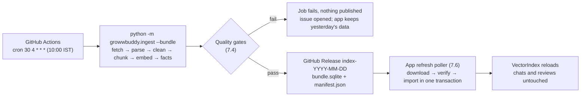

# GrowwBuddy Implementation Plan

> **Facts-only. No investment advice.**

This plan breaks the build of GrowwBuddy into phases. It implements the design in [architecture.md](architecture.md), which in turn meets the requirements in [problemStatement.md](problemStatement.md). Section numbers like "§6.5" refer to `architecture.md`.

**How to use this plan**

- Work through the phases in order. Each one ends in something you can run and check.
- Each phase lists its **tasks** (with IDs for tracking), the **files** it creates, its **tests**, and an **exit check** that must pass before the next phase starts.
- Effort estimates assume one developer and are rough guides, not commitments.

---

## LLM Provider: Groq (decision, fixed)

GrowwBuddy uses **Groq** for every model call (router, answer generator, ingestion-time fact extraction). This replaces the Claude API design in architecture §3, §7 and §14 "Configuration"; where they disagree, this section wins. The rest of the design is unchanged: structured outputs, code-added citations and the deterministic validator.

| Setting | Value | Notes |
|---|---|---|
| SDK | `groq` (official Python SDK), `AsyncGroq` client | OpenAI-style Chat Completions API |
| Model | `openai/gpt-oss-120b` | Read from `GROQ_MODEL`. Chosen because Groq supports **strict** structured outputs on it. If you change the model, it must also support strict mode, and the eval (Phase 6) must pass on it before switching. |
| Reasoning effort | `reasoning_effort="low"` | Read from `GROWWBUDDY_REASONING_EFFORT`. GPT-OSS accepts `low`, `medium` and `high`. Raise it only if the eval shows a gain, since more reasoning uses more of the token limits below. |
| Reasoning output | `include_reasoning=False`; never send `reasoning_format` | GPT-OSS returns its reasoning in a `reasoning` field by default; we don't use it, and it must never be logged. `reasoning_format` isn't supported on GPT-OSS. |
| Structured output | `response_format={"type": "json_schema", "json_schema": {"name": ..., "strict": true, "schema": ...}}` | Schemas from architecture §7.3, **adjusted as in "Structured outputs: docs check" below**. Strict mode needs every field `required` and `additionalProperties: false`. Validate the JSON again with Pydantic after parsing. No streaming or tool use: Groq doesn't support them together with structured outputs. |
| Sampling | `temperature=0` | Repeatable answers for the eval |
| `max_completion_tokens` | 1024 (answer), 512 (router) | Answers are at most 3 sentences. Groq's docs don't say whether reasoning tokens count toward this limit; assume they do, and watch the `finish_reason="length"` rate in the usage logs (task 3.4). |
| Stop check | Read `choices[0].finish_reason` before the content | Only `"stop"` is accepted. `"length"`, an empty message, a schema/JSON error or an API error leads to the safe fallback (§6.5). Groq has no server-side refusal fallback. |
| Client config | `max_retries=2`, `timeout=30s` | From `GROWWBUDDY_LLM_MAX_RETRIES` and `GROWWBUDDY_LLM_TIMEOUT_S`. 429 handling is in task 3.4. |
| Prompt caching | Automatic on supported models; read `usage.prompt_tokens_details.cached_tokens` | Keep system prompts static so they can be cached. Cached tokens don't count toward Groq's rate limits, so caching also stretches the token budget. A value of 0 is harmless. |
| Credential | `GROQ_API_KEY` | Needed only when a model is actually called; never in CI (model calls are mocked) |

### Structured outputs: docs check (12 Nov 2026)

Checked against Groq's [structured outputs](https://console.groq.com/docs/structured-outputs), [rate limits](https://console.groq.com/docs/rate-limits) and [reasoning](https://console.groq.com/docs/reasoning) docs.

- **Confirmed:** `openai/gpt-oss-120b` supports strict mode (`strict: true`). Groq describes it as constrained decoding that never produces invalid JSON. Every field must be `required`, objects need `additionalProperties: false`, and `enum` works.
- **Not confirmed:** the docs don't show `minItems`/`maxItems` or nullable unions (`["string", "null"]`) in strict mode. The §7.3 schemas use both. Rather than depend on them, the schemas sent to Groq change as follows. The Pydantic models (task 3.5) convert the sentinels back to `None` and enforce the limits.

| Schema | §7.3 has | Send to Groq instead | Enforced by |
|---|---|---|---|
| Router (3.7) | `scheme`: `["string", "null"]` with `null` in the enum, plus `hdfc-elss` | `scheme`: string enum of the five scheme keys plus `"none"`. `hdfc-elss` is dropped: it isn't in the corpus (Phase 1). | Pydantic maps `"none"` → `None` |
| Answer (3.9) | `sentences`: `minItems: 1`, `maxItems: 3` | `sentences`: array of strings, no item limits | Pydantic (1–3 items) and the validator's sentence count (3.10) |
| Answer (3.9) | `source_chunk_id`: `["string", "null"]` | `source_chunk_id`: string, `""` when `answerable` is false | Pydantic maps `""` → `None`; the validator checks the ID exists (3.10) |
| Exit-load extraction (2.8) | — | Already uses only `boolean` and `string` fields | No change |

- **Keep the safety checks anyway:** strict mode should rule out invalid JSON, but a reply cut off at `max_completion_tokens` still arrives with `finish_reason="length"`. So the stop check and the Pydantic validation stay.
- **Live check before the Phase 3 exit:** send each of the three schemas to Groq once (task 3.4) and confirm none is rejected with a 400. If one is, simplify that schema further; don't switch to best-effort mode.

### Groq rate limits and budget

Limits for `openai/gpt-oss-120b`, matching the plan's free-tier figures:

| Limit | Value |
|---|---|
| Requests per minute (RPM) | 30 |
| Requests per day (RPD) | 1,000 |
| Tokens per minute (TPM) | 8,000 |
| Tokens per day (TPD) | 200,000 |

- **One budget for everything:** Groq applies limits per organisation, so the chat app, the eval and ingest-time extraction all share it.
- **Confirm your plan's numbers:** the rate-limits page doesn't make clear whether this table row is the Free or the Developer plan. Check the exact limits for your organisation on Groq's console limits page before setting the budget. The limits are config values (below), so a plan change only edits `.env`.
- **Signals Groq sends:** going over a limit returns `429 Too Many Requests` with a `retry-after` header (in seconds). Every response also carries `x-ratelimit-remaining-requests` and `x-ratelimit-reset-requests` (per day), and `x-ratelimit-remaining-tokens` and `x-ratelimit-reset-tokens` (per minute).
- **Cached tokens don't count** toward the limits.

**Rough budget.** These are estimates; replace them with measured numbers from the usage logs (task 3.4) before setting the limits in 6.4.

| Message kind | Groq calls | Tokens (approx.) |
|---|---|---|
| Handled by rules: PII, advisory, NAV/performance, greeting | 0 | 0 |
| Factual question through the LLM router and generator | 2 | ~2,500 (router ~1,000 + answer ~1,500) |
| Same, with one validator retry (3.10) | 3 | ~4,000 |

**Tokens are the binding limit:**
- 8K tokens per minute is about **3 model-answered messages per minute across all users**.
- 200K tokens per day is about **80 per day**.
- Requests allow much more: about 15 per minute and 500 per day.

So the free tier supports a demo or a small pilot, not public traffic. Add this to Known Limitations (task 8.4).

### Configuration (`.env`)

This replaces the table in architecture §14.

| Variable | Default | Purpose |
|---|---|---|
| `GROQ_API_KEY` | — | Groq API credential |
| `GROQ_MODEL` | `openai/gpt-oss-120b` | Router, generator and fact-extraction model. **Rename when task 3.4 is built:** `config.py` and `.env.example` still read `GROWWBUDDY_MODEL`; accept that as a fallback so existing `.env` files keep working. |
| `GROWWBUDDY_REASONING_EFFORT` | `low` | `reasoning_effort` (`low`, `medium`, `high`) |
| `GROWWBUDDY_LLM_TIMEOUT_S` | `30` | Per-request timeout |
| `GROWWBUDDY_LLM_MAX_RETRIES` | `2` | SDK retries |
| `GROWWBUDDY_LLM_MAX_RETRY_WAIT_S` | `10` | Longest `retry-after` a chat request waits on a 429; anything longer gets the busy reply (task 3.4) |
| `GROWWBUDDY_GROQ_RPM` | `30` | Groq requests per minute for the organisation |
| `GROWWBUDDY_GROQ_RPD` | `1000` | Groq requests per day |
| `GROWWBUDDY_GROQ_TPM` | `8000` | Groq tokens per minute |
| `GROWWBUDDY_GROQ_TPD` | `200000` | Groq tokens per day |
| `GROWWBUDDY_GROQ_HEADROOM` | `0.8` | Share of each Groq limit the chat app may use; the rest is kept for the eval and ingest (task 6.4) |
| `GROWWBUDDY_CLIENT_PER_MINUTE` | `2` | Model-answered messages per minute per `client_id` (task 6.4). Rule-handled messages don't count. |
| `GROWWBUDDY_CLIENT_PER_DAY` | `20` | Model-answered messages per day per `client_id` |
| `GROWWBUDDY_IP_PER_MINUTE` | `4` | Model-answered messages per minute per IP address (EC-API-05) |
| `GROWWBUDDY_IP_PER_DAY` | `40` | Model-answered messages per day per IP address |
| `GROWWBUDDY_DB_URL` | `sqlite:///<project>/data/growwbuddy.db` | Thread and facts store |
| `GROWWBUDDY_EMBED_MODEL` | `intfloat/e5-small-v2` | Embedding model (Phase 2 data research). Vectors are stored in `GROWWBUDDY_DB_URL`; no separate vector store. |
| `GROWWBUDDY_HISTORY_TURNS` | `6` | Turns used for query rewriting |
| `GROWWBUDDY_RETRIEVAL_MIN_SCORE` | unset (set from the Phase 6 eval) | Low-confidence cutoff: minimum top score |
| `GROWWBUDDY_RETRIEVAL_MIN_GAP` | unset (set from the Phase 6 eval) | Low-confidence cutoff: minimum gap between the top and second scores (task 6.3). Added to `config.py` in Phase 6; both cutoffs are left unset (see "Phase 6 results"). |
| `GROWWBUDDY_THREAD_RETENTION_DAYS` | `30` | Threads with no activity for this many days are deleted (task 6.7); `0` keeps them |
| `GROWWBUDDY_STALE_DAYS` | `3` (was `45` before Phase 7) | Source staleness threshold, in days since the source was last fetched or confirmed unchanged by the daily heartbeat (task 7.7). |
| `GROWWBUDDY_FRONTEND_ORIGIN` | `http://localhost:5173` | Allowed CORS origin (task 4.9) |
| `GROWWBUDDY_FRONTEND_DIST` | `<project>/frontend/dist` | Built web UI, served at `/` when its `index.html` exists (task 5.10) |
| `GROWWBUDDY_CORPUS_DIR` | `<project>/corpus` | `sources.yaml` and `raw/` downloads |
| `GROWWBUDDY_PARSED_DIR` | `<project>/data/parsed` | Parsed page JSON, one file per source |
| `GROWWBUDDY_RAW_KEEP` | `5` | Raw HTML copies kept per source |
| `GROWWBUDDY_INDEX_REPO` | unset | Phase 7: GitHub repository (`owner/name`) whose `index-*` releases the app pulls. Unset means no polling (local `make ingest` only). |
| `GROWWBUDDY_INDEX_POLL_MINUTES` | `60` | Phase 7: how often the app checks for a newer index bundle |
| `GROWWBUDDY_INDEX_TOKEN` | unset | Phase 7: read-only token, needed only if the repository is private |

---

## Phase Overview

| Phase | Goal | Depends on | Est. effort | Output you can see |
|---|---|---|---|---|
| 0 | Project setup | — | 0.5 day | Repo skeleton, tooling, CI running empty tests |
| 1 | Corpus and ingestion | 0 | 1.5–2 days | The five Groww scheme pages downloaded and parsed to text |
| 2 | Indexing and scheme facts | 1 | 2 days | Searchable index and a verified facts table |
| 3 | Query pipeline (CLI) | 2 | 3–4 days | Ask a question in the terminal, get a validated answer |
| 4 | API and multi-thread support | 3 | 2 days | Working REST API with independent threads |
| 5 | Web UI | 4 | 2–3 days | Chat app in the browser |
| 6 | Evaluation and hardening | 5 | 2–3 days | Metrics targets met; rate limiting, logging, refresh job |
| 7 | Daily data refresh (GitHub Actions) | 6 | 2–3 days | Data rebuilt every day at 10:00 IST; the app switches to it automatically |
| 8 | Documentation and release | 7 | 1 day | README and a runnable release |
| | | | **~17–22 days** | |

---

## Phase 0 — Project Setup

**Goal:** an empty but working project, so every later phase only adds code.

### Tasks

| ID | Task | Notes |
|---|---|---|
| 0.1 | Create the folder layout from §14 (`backend/`, `frontend/`, `corpus/`, `data/`, `docs/`) | |
| 0.2 | `backend/pyproject.toml` with Python 3.11+, dependencies from §3 | `fastapi`, `uvicorn`, `groq`, `pydantic-settings`, `sqlalchemy`, `chromadb`, `sentence-transformers`, `rank_bm25`, `beautifulsoup4`, `httpx`, `pyyaml`, `slowapi`, `apscheduler`; dev: `pytest`, `pytest-asyncio`, `ruff`, `mypy` |
| 0.3 | `growwbuddy/config.py` using `pydantic-settings`, reading every variable in the Configuration table above | Defaults as listed; `GROQ_API_KEY` required only when the model is called |
| 0.4 | `.env.example` and `.gitignore` (`.env`, `data/`, `corpus/raw/`, `node_modules/`, `__pycache__/`) | Never commit `.env` |
| 0.5 | Lint/format/type-check config (`ruff`, `mypy`) and a `Makefile` or task runner with `lint`, `test`, `ingest`, `serve`, `eval` | |
| 0.6 | CI workflow (GitHub Actions or similar): lint + unit tests on every push | No API key in CI; model calls are mocked (§12.3) |
| 0.7 | Shared constants module: disclaimer text, the five scheme keys, allowed domain (`groww.in`), footer format | One place for strings that the UI, validator and tests all use |

### Files

`backend/pyproject.toml`, `backend/growwbuddy/config.py`, `backend/growwbuddy/constants.py`, `.env.example`, `.gitignore`, `Makefile`, `.github/workflows/ci.yml`

### Exit check

- [ ] `make lint` and `make test` pass locally and in CI
- [ ] `python -c "from growwbuddy.config import settings; print(settings.model)"` prints `openai/gpt-oss-120b`

---

## Phase 1 — Corpus and Ingestion

**Goal:** the five Groww scheme pages are downloaded, checked against the manifest, and parsed into clean, sectioned text with an "as on" date.

**Decision (fixed):** the corpus is **exactly the five Groww URLs** from the problem statement. No other URLs are fetched, indexed or cited: no HDFC MF PDFs, no AMFI or SEBI pages, no ELSS scheme. This replaces the multi-source corpus in architecture §4.3.

| Source ID | Scheme key | URL |
|---|---|---|
| `groww-hdfc-mid-cap` | `hdfc-mid-cap` | https://groww.in/mutual-funds/hdfc-mid-cap-fund-direct-growth |
| `groww-hdfc-small-cap` | `hdfc-small-cap` | https://groww.in/mutual-funds/hdfc-small-cap-fund-direct-growth |
| `groww-hdfc-large-cap` | `hdfc-large-cap` | https://groww.in/mutual-funds/hdfc-large-cap-fund-direct-growth |
| `groww-hdfc-silver-etf-fof` | `hdfc-silver-etf-fof` | https://groww.in/mutual-funds/hdfc-silver-etf-fof-direct-growth |
| `groww-hdfc-multi-cap` | `hdfc-multi-cap` | https://groww.in/mutual-funds/hdfc-multi-cap-fund-direct-growth |

### Tasks

| ID | Task | Notes |
|---|---|---|
| 1.1 | Write `corpus/sources.yaml` with exactly the five entries above (`format: html`, `doc_type: scheme_page`) and `allowed_domains: [groww.in]` | This list is final; adding a URL means changing this plan first |
| 1.2 | Refusal and performance links (§8): use the matching Groww scheme page from the five URLs; if no scheme is named, use the page of the scheme from the thread's previous turn, else the general refusal without a scheme link | No AMFI/SEBI links. See "Open Decisions" for the gap this leaves against the problem statement. |
| 1.3 | Manifest loader with schema validation (Pydantic): exactly five entries, unique IDs, scheme keys from §4.2 (minus `hdfc-elss`), every URL on `groww.in`, and each URL matches the fixed list above | Fail loudly if an entry is added, removed or changed |
| 1.4 | `ingest/fetch.py`: download with `httpx`, retry with backoff, generic `User-Agent` (no personal details), re-check the final URL is still on `groww.in` **after redirects** | Store to `corpus/raw/<source_id>/<yyyy-mm-dd>.html`. **Done:** the pages render their fund data server-side, so no headless browser (Playwright) is needed. Redirects are followed by hand and each hop is domain-checked before it is requested. |
| 1.5 | Source registry table (`sources_state`): `source_id`, `fetched_at`, `last_checked_at`, `http_last_modified`, `sha256`, `status` | Used for change detection (§5.1 step 2) and staleness (§13). Hash the extracted fund content, not the whole HTML, so ad or layout changes don't trigger re-parsing. |
| 1.6 | `ingest/parse_groww.py`: check whether the page embeds structured fund data (e.g. a JSON blob in a `<script>` tag); if so, read fields from it, otherwise extract visible text with `trafilatura`, `BeautifulSoup` as fallback | **Done:** every page embeds the fund data as JSON (`__NEXT_DATA__`), and the parser reads an allow-list of fields from it. A page without that JSON is rejected, not scraped, so a bot-check or error page is never indexed; `trafilatura` was dropped. Field choices and data quirks are in [corpus-notes.md](corpus-notes.md). |
| 1.7 | Section tagging: split each page into named sections (e.g. fund details, expense ratio, exit load, minimum investment / SIP, riskometer, benchmark, fund manager, about the fund, tax) | Section names become the `section` metadata in §5.2 and help match questions to facts |
| 1.8 | `ingest/dates.py`: extract the date the page states for its data (e.g. NAV or expense-ratio "as on" date); fall back to `fetched_at` | Handle formats like `31-Oct-2026`, `31 Oct 2026`, `31/10/2026` |
| 1.9 | Coverage report: `python -m growwbuddy.ingest --report` prints, for each scheme, which supported question types (§2 of the problem statement) its page actually answers | Gaps found here become "not found" answers and go into Known Limitations |
| 1.10 | CLI: `python -m growwbuddy.ingest [--source ID] [--force]` running fetch → hash check → parse, writing parsed output to `data/parsed/<source_id>.json` | Indexing is added in Phase 2 |

`pdfplumber` is no longer needed; remove it from the dependencies in task 0.2.

### Tests

- Manifest validation rejects a sixth URL, a non-`groww.in` domain, a changed URL and a duplicate ID.
- Fetcher rejects a URL that redirects off `groww.in` (mocked HTTP).
- Unchanged content hash skips parsing.
- Date extractor handles each format above; returns the fallback when no date is present.
- Parser snapshot tests on a saved copy of each of the five pages, so a Groww layout change shows up as a failing test.

### Exit check

- [x] All five pages download and parse with no errors
- [x] Spot-check: for each scheme, the parsed output contains its expense ratio, exit load, minimum SIP, riskometer and benchmark
- [x] Every parsed page has an `as_of_date`
- [x] Coverage report reviewed, and each unanswerable question type is listed in Known Limitations (see [corpus-notes.md](corpus-notes.md))

Checked on 12 Nov 2026 against live pages (data as of 11 Nov 2026).

---

## Phase 2 — Indexing and Scheme Facts

**Goal:** parsed documents become searchable chunks, and the most-asked facts are stored in a verified table.

**Input:** `data/parsed/<source_id>.json` from Phase 1. Its `sections` become chunks; its `fields` feed the facts table (2.7). Both come from the same parsed values, so search results and facts can't disagree. Raw HTML is never chunked.

### Data research (12 Nov 2026)

These decisions come from a study of the parsed data, which replaces the generic RAG defaults in architecture §3 and §5. The scripts were throwaway experiments, not project code.

**What the data looks like**

| Finding | Number | Consequence |
|---|---|---|
| Corpus size | 5 pages, 45 sections, 1,089 words in total | Tiny. Scale-oriented tooling isn't needed. |
| Section length | 14–41 words (83–238 characters) | Far below any token cap. No splitting or overlap is needed. |
| Tables | None (data comes from JSON) | The "one chunk per table" rule doesn't apply |
| Near-identical sections across schemes | Riskometer and minimum investment: 1 distinct text once the scheme name is removed; exit load and tax: 2. Cosine similarity between schemes is 0.83–0.96. | Embeddings can't tell schemes apart. The scheme filter must come from the router, never from similarity. |
| Mixed section | `fund_details` combines launch date, category, registrar and stamp duty | It was the most-missed section in retrieval tests |
| Dated facts | Only `expense_ratio` has its own `as_on` (10 Nov), one day before the page's `as_of_date` (11 Nov) | The footer should use the fact's own date (task 3.11) |

**Retrieval tests.** 180 queries (9 question types × 5 schemes × 4 wordings, including typos, abbreviations and Hinglish), plus 90 held-out queries worded to avoid the header keywords. "Filtered" means search runs only within the resolved scheme's chunks, as in production.

| Setup | Filtered top-1 | Filtered top-3 | Held-out top-1 / top-3 |
|---|---|---|---|
| BM25 (keyword), plain text | 60% | 86% | — |
| `bge-small-en-v1.5`, plain text | 71% | 86% | 66% / 80% |
| `bge-small-en-v1.5` + BM25 (RRF hybrid), plain text | 73% | 94% | — |
| `bge-base-en-v1.5`, plain text | 74% | 92% | 66% / 91% |
| `bge-small-en-v1.5`, **enriched text** | 91% | 97% | 89% / 98% |
| `e5-small-v2`, **enriched text** | **95%** | **99%** | **89% / 100%** |
| `e5-small-v2`, enriched + BM25 (RRF hybrid) | 94% | 98% | — |
| `e5-small-v2`, enriched, `fund_details` split per fact (12 fund-details-heavy queries × 5 schemes) | 93% (was 77%) | 100% (was 98%) | — |

"Enriched text" means the embedded text starts with a short header: the scheme's name and aliases, plus keywords for the section, e.g. `HDFC Mid Cap Fund (midcap) | Expense ratio | TER | total expense ratio | annual fee`. Only the embedding sees the header; the model and the user see the plain section text.

**Decisions**

| Area | Before | Now | Why |
|---|---|---|---|
| Chunk unit | Split by headings, ~400 tokens, 50 overlap | **One chunk per parsed section.** `fund_details` is split into one section per fact (launch date, category, registrar, stamp duty), giving ~60 chunks. | Sections are already small and self-contained (each names its scheme). Splitting the mixed section raised its top-1 from 77% to 93%. |
| Embedded text | Chunk text | **Header + chunk text** (scheme aliases + section keywords) | The biggest single gain: +18 to +24 points top-1 on every model |
| Embedding model | `bge-small-en-v1.5` | **`intfloat/e5-small-v2`** (384 dims, ~130 MB, CPU) | Best or tied-best in every test, at the same size and speed as bge-small. `bge-base` (3× slower) was no better. Needs the `query: ` / `passage: ` prefixes. |
| Keyword search | BM25 + RRF hybrid | **Dropped** | Once enriched, the hybrid didn't help (94% vs 95% top-1). One less index to keep in sync. Revisit only if the Phase 6 eval shows exact-term misses. |
| Vector database | ChromaDB | **SQLite table + in-memory NumPy search** | Chroma pulls in 28 dependencies (kubernetes alone is 117 MB) to search ~60 vectors. NumPy brute force takes ~7 µs per query. Vectors live in the same SQLite file as the facts, so one transaction swaps both (EC-ING-22, EC-RET-07). |
| Chunk IDs | `<source_id>#<nnn>` | **`<source_id>#<section>`**, e.g. `groww-hdfc-mid-cap#expense_ratio` | Stable when a section appears or disappears; readable in logs and eval reports |
| Retrieval role | Main path | **Backup to the facts table** | Core questions are answered from verified `scheme_facts` (task 3.8 step 1). Chunks serve paraphrases, follow-ups and less common facts. |

**Limits of this study:** the questions were written by us, not real users, and 45–60 chunks is a very small corpus. The Phase 6 eval is the real test. If it shows retrieval misses, the header keywords are the first thing to tune, since they're data, not code.

### Tasks

| ID | Task | Notes |
|---|---|---|
| 2.1 | `ingest/chunk.py`: one chunk per section in `data/parsed/<source_id>.json`. Store two texts: `text` (the plain section, shown to the model) and `embed_text` (`<header>\n<text>`). Change `parse_groww.py` so `fund_details` becomes four sections: `launch_date`, `category`, `registrar`, `stamp_duty`; refresh the parser snapshots. | Metadata per chunk: `chunk_id`, `source_id`, `scheme`, `section`, `title`, `doc_type`, `source_url`, `as_of_date` (page), `fact_as_on` (the section's own fact date, e.g. expense ratio; else null), `embed_model`, `content_sha256`. Guard: fail if a chunk exceeds 256 tokens (no current section is near it). |
| 2.2 | `chunk_id = <source_id>#<section>` | Stable across re-ingests; never a running number |
| 2.3 | `retrieval/embed.py`: an `Embedder` interface; default `E5Embedder` loads `intfloat/e5-small-v2` once, adds `passage: ` to chunks and `query: ` to queries, and returns normalised vectors | The model name is stored with every vector. If the configured model differs from the stored one, re-embed everything and refuse to query a mixed index (EC-ING-25). Download the model once on first run; README says so (EC-ING-24). |
| 2.4 | `retrieval/headers.py` (or `corpus/retrieval_headers.yaml`): scheme aliases and section keywords used to build `embed_text` | Version-controlled data. Aliases are shared with the router (EC-INT-21, 23); verify old scheme names (e.g. "HDFC Top 100") before adding them. |
| 2.5 | `retrieval/vector.py`: `chunks` table in SQLite (text, `embed_text`, metadata, embedding as a float32 BLOB). `VectorIndex` loads all rows into a NumPy matrix at startup and on index change; `search(query_vec, scheme, k)` filters by scheme, then ranks by cosine similarity. | All chunks are rebuilt on every changed ingest (<1 s for ~60). Chunks and facts are written in one transaction, so a query never sees a half-built index. Behind an interface, so `sqlite-vec`, pgvector or Chroma can replace it if the corpus grows past ~100k chunks. |
| 2.6 | `store/models.py`: `scheme_facts` table (§5.3) | Plus a `scheme_facts_history` table for fact diffing (§13) |
| 2.7 | `ingest/extract_facts.py`: rule-based extractors that read the parsed `fields` (expense ratio (Direct plan), min SIP, min lump sum, benchmark, riskometer, lock-in, fund manager) | Values are already structured (Phase 1), so these are parsers of known formats rather than page scrapers |
| 2.8 | LLM fallback extractor for fields regex can't handle (exit load wording) using Groq strict structured output, run **only at ingestion** | Uses the settings in "LLM Provider: Groq". Check `finish_reason` before reading output. |
| 2.9 | Sanity checks (§5.3): TER 0–3%, positive rupee min SIP, riskometer ∈ six SEBI levels, lock-in only if the page states one | Failures stored with `verified = false` |
| 2.10 | `python -m growwbuddy.facts review`: prints unverified facts with source snippets; lets you mark them verified or enter a manual value (`extracted_by = manual`) | Human-in-the-loop for accuracy (P1) |
| 2.11 | Wire chunking, indexing and fact extraction into the ingest CLI | |

### Tests

- One chunk per section; `fund_details` arrives as four separate sections; no chunk exceeds the 256-token guard.
- Re-ingesting the same source gives the same `chunk_id`s; a section that disappears removes only its own chunk.
- `embed_text` starts with the header; `text` (sent to the model) never contains it.
- `fact_as_on` is set on the expense-ratio chunk and null where the section has no fact date.
- Vector search with a scheme filter never returns another scheme's chunk.
- Changing `GROWWBUDDY_EMBED_MODEL` triggers a full re-embed; a mixed-model index is refused.
- A query during a re-index sees either the old or the new index, never a mix.
- Each sanity check accepts a valid value and rejects an invalid one.
- Fact extractor fixtures: saved Groww page → expected TER value.
- Tests use a fake `Embedder` (deterministic vectors), so CI never downloads the model.

### Exit check

- [ ] Every scheme has a **verified** value for expense ratio, exit load, min SIP, benchmark and riskometer, wherever its Groww page states it. **Automated part done:** all 35 facts (7 per scheme) pass the sanity and conflict checks. **Still open:** the manual check against the live pages (EV-2-12, blocking): `python -m growwbuddy.facts review --reviewer <name>`.
- [x] A quick search script (`python -m growwbuddy.retrieval.debug "exit load mid cap"`) returns the right chunk in the top 3. The eval.md §4.2 smoke set gets 7/7 in the top 3.
- [ ] The retrieval study's 180 queries, saved as `eval/retrieval_queries.jsonl`, reach ≥ 90% filtered top-1 and ≥ 97% filtered top-3. **Not met:** see "Phase 2 results" below.

**Dependency and config changes (done):** removed `chromadb` and `rank_bm25` from `pyproject.toml` and added `numpy`; removed `GROWWBUDDY_CHROMA_DIR`; `GROWWBUDDY_EMBED_MODEL` now defaults to `intfloat/e5-small-v2`.

### Phase 2 results (12 Nov 2026)

Built as planned: 60 chunks (12 sections × 5 pages) and 35 facts, all extracted by rules. All five exit loads match a known wording, so the LLM fallback (task 2.8) wasn't called, but it's tested with a mocked client. Additions beyond the task list: an ingest lock file (EC-ING-21); a TER conflict check that compares the headline TER with the newest value in the page's own TER history (EC-FCT-10); and a build key, so an ingest with nothing changed skips re-embedding.

**Retrieval accuracy** (`python -m growwbuddy.retrieval.evaluate`, real `e5-small-v2`, filtered by scheme):

| Query set | Top-1 | Top-3 | Top-5 |
|---|---|---|---|
| `retrieval_queries.jsonl` (180), first header keywords | 80.0% | 86.1% | 91.1% |
| Same set, after tuning header keywords | 88.3% | 95.6% | 98.3% |
| `retrieval_queries_heldout.jsonl` (45, written after tuning, never tuned on) | 77.8% | 93.3% | 97.8% |

- The study's original 180 queries were throwaway, so `retrieval_queries.jsonl` was **rewritten** to the same design (9 types × 5 schemes × 4 wordings: plain, typo, abbreviation, Hinglish). It looks harder than the original: plain wording scores 98% / 100%.
- What's left is mostly **typos** (76% top-1 on the 180 set). Misspellings were not added to the headers, to avoid fitting the test set. In production the router's rewritten query fixes spelling before retrieval (EC-INT-22).
- The short `registrar` chunk is the most common wrong top-1 for terse queries.
- The generator receives the top 5 (task 3.8), and core questions are answered from `scheme_facts` first, so top-5 is closer to what users will see.

**Expense ratio fix (13 Nov 2026).** Groww publishes two expense ratios: `base_expense_ratio`, excluding GST and statutory charges (e.g. small cap 0.64%), and `expense_ratio`, including them (0.79%). Only the second was stored. A signed-in browser now shows the base figure, so answers disagreed with the cited page. Now both are stored as verified facts (`expense_ratio_base` and `expense_ratio_direct`, 8 facts per scheme, 40 in total). Each has its own TER-history conflict check, and a base figure above the total flags both. The `expense_ratio` chunk and the facts context both state the two labelled figures, so an answer quoting both passes the number check. Answer prompt rule 9 asks for both. Re-ingested on 13 Nov; the manual review (EV-2-12) must also confirm the five new base figures.

**Decision needed before Phase 3:** accept and re-measure in Phase 6 on router-rewritten queries; or try more retrieval changes first (e.g. bring back BM25, test `bge-base`); or revise the targets.

---

## Phase 3 — Query Pipeline (CLI)

**Goal:** the full answer pipeline from §6 works end to end from the terminal, before any API or UI exists.

### Tasks

| ID | Task | Notes |
|---|---|---|
| 3.1 | `pipeline/pii_guard.py`: detectors from §6.1 (PAN, Aadhaar with Verhoeff check, phone, email, OTP, account/folio) | Returns which type matched, never the matched value |
| 3.2 | `pipeline/refusals.py`: fixed templates from §8 (advisory, comparison, performance, out of scope, not found, PII), plus **busy**: "GrowwBuddy is busy right now. Please try again shortly." | Links are the five Groww scheme pages only (task 1.2). The busy reply has no link and no footer, and gets its own response `type` (`busy`) so the UI can style it (task 5.6). |
| 3.3 | `pipeline/router_rules.py`: stage 1 keyword rules (§6.2) | Include NAV-type words ("NAV", "net asset value", "unit price", "current price") → `performance`: the performance reply, linking the scheme's Groww page with no figure (EC-INT-06). The corpus has no NAV value, and retrieval can't tell: a NAV query's top score (0.895) was close to a real match (0.927) in the Phase 2 tests. So this rule, not retrieval, must catch it. |
| 3.4 | `llm/client.py`: one wrapper around `AsyncGroq` applying the settings in "LLM Provider: Groq" (model from `GROQ_MODEL`, `reasoning_effort` `low`, `include_reasoning=False`, `temperature=0`, strict `json_schema` output, retries, timeout) | Single place to change model settings. Mockable for tests. A minimal version already exists from Phase 2 (task 2.8); extend it. See the 3.4 notes below the table. |
| 3.5 | `llm/schemas.py`: Pydantic models for the router and answer schemas (§7.3) | Use the adjusted schemas in "Structured outputs: docs check": no `minItems`/`maxItems` and no nullable unions in what's sent to Groq. Map the sentinels (`"none"`, `""`) back to `None`, and enforce 1–3 sentences, in Pydantic. |
| 3.6 | `prompts/router_system.md` and `prompts/answer_system.md` (§7.4) | Static text, no dates or IDs, so it can be cached (§7.5) |
| 3.7 | `pipeline/router.py`: stage 2 LLM classifier → `{intent, scheme, rewritten_query}`; tie-break to `advisory` when unsure | Takes recent thread history as input. `scheme` is one of the five keys or `"none"` (no `hdfc-elss`, no `null`). |
| 3.8 | `retrieval/retriever.py`: verified facts lookup → vector search filtered to the resolved scheme → top 5 → low-confidence exit (§6.3) | No BM25, RRF or doc-type boost (Phase 2 data research: one doc type, and hybrid didn't help). With no resolved scheme, don't search across schemes; ask which scheme (EC-RET-03). The low-confidence cutoff is model-specific; tune it for `e5-small-v2` in Phase 6. |
| 3.9 | `pipeline/generator.py`: build context with labelled `chunk_id`s, call Groq, parse structured answer; `answerable: false` → not found | Check `finish_reason`; anything other than `stop`, or invalid JSON → safe fallback. A rate-limit failure from 3.4 → the busy reply, not the not-found fallback. `source_chunk_id` is `""` when not answerable. |
| 3.10 | `pipeline/validator.py`: all checks in §6.5 (sentence count, one valid citation, no URLs in text, advice blocklist, no return figures); one retry with error feedback, then fallback | Sentence splitter must handle "Rs.", "e.g.", decimals |
| 3.11 | `pipeline/formatter.py`: build the response object (§6.6). Footer date = the **cited chunk's `fact_as_on`** when present, otherwise the cited source's `as_of_date`, otherwise `fetched_at` | The fact's own date is the most accurate "last updated" for that answer (e.g. expense ratio as on 10 Nov, while the page's NAV date is 11 Nov). For answers from the facts table, use the fact's `as_on` the same way. Format: "31 Oct 2026". |
| 3.12 | `pipeline/orchestrator.py`: wires 3.1 → 3.11 into one `handle_message(text, history)` function | |
| 3.13 | CLI REPL: `python -m growwbuddy.chat` keeping in-memory history | For manual testing only |
| 3.14 | Verify prompt caching: log `usage.prompt_tokens_details.cached_tokens` and check whether it's > 0 on repeat calls | Depends on Groq's caching support for the chosen model; 0 is acceptable |

**Task 3.4 notes: rate limits and usage logging**

*Handling 429 (rate limited):*
- **Short waits:** on a 429, read `retry-after` (seconds). If it's at most `GROWWBUDDY_LLM_MAX_RETRY_WAIT_S` (10 s), wait that long and retry, within `GROWWBUDDY_LLM_MAX_RETRIES`. If the header is missing, use exponential backoff with jitter (about 1 s, then 2 s).
- **Long waits:** if `retry-after` is longer than that, don't wait. A daily limit can mean hours, and the user is waiting.
- **One retry layer only:** check whether the SDK's built-in retry already honours `retry-after`. Use one retry layer, not two, so a single 429 can't turn into four requests.
- **Never crash:** when retries run out or the wait is too long, return `JsonResult(ok=False, error="rate_limited", retry_after_s=...)`. No exception and no HTTP 500. The orchestrator turns it into the busy reply (task 3.2).
- **Other failures keep their fallbacks:** timeouts, 5xx errors and a missing key still get the normal safe fallbacks (EC-GEN-01, 03).
- **Busy messages aren't stored as failed:** a message that gets the busy reply is not written as a failed answer, so the user can simply send it again.

*Logging usage per call:* one structured log line per Groq call, with **no message text** (§11). Fields:
- call kind (`router`, `answer`, `answer_retry`, `extract`) and model
- `prompt_tokens`, `completion_tokens`, `cached_tokens` and total tokens
- `finish_reason` and latency
- the rate-limit headers `x-ratelimit-remaining-tokens` and `x-ratelimit-remaining-requests` (read via the SDK's raw-response access, e.g. `with_raw_response`)
- for a 429: `retry-after`

Also keep in-process counters of tokens and requests for the current minute and day, so 6.4 can enforce the budget. Log a warning when usage passes 80% of any Groq limit. These logs are the measured input that replaces the rough budget in "Groq rate limits and budget".

*Live schema check:* `python -m growwbuddy.llm.check` sends each schema (router, answer, exit-load) to Groq once and reports whether it was accepted. Run it before the Phase 3 exit. It uses a few hundred tokens.

### Tests

- **Groq client (mocked HTTP):**
  - a 429 with `retry-after: 1` is retried and succeeds;
  - a 429 with `retry-after: 3600` isn't waited on and gives `rate_limited` at once;
  - repeated 429s stop after the retry limit, with no more requests than allowed;
  - a 429 with no `retry-after` uses backoff;
  - none of these raises an exception.
- **Busy reply:** the orchestrator turns `rate_limited` into `type: "busy"`, with the busy text, no link and no footer, and doesn't store the message as a failure.
- **Usage log:** each call logs the token counts and rate-limit headers; log lines never contain the message or the reasoning text.
- **Schemas:** the JSON schemas sent to Groq have no `minItems`, `maxItems` or `null` types; Pydantic rejects 0 or 4 sentences and maps `"none"` and `""` to `None`.
- **PII:** each type is caught; harmless numbers (e.g. "₹500 SIP", a year) are not; matched values never appear in logs.
- **Router rules:** "Should I invest in X?" and "Which is better?" → `advisory`; "3-year return" → `performance`.
- **NAV rule:** "What's the NAV of HDFC large cap mutual fund?", "net asset value of mid cap", "unit price of the silver FoF" and "current price of multi cap" → `performance`, handled by stage 1 with no LLM router call and no retrieval (check with mocks that fail if called). The reply links the matching Groww page and contains no number. Words that only contain "nav" (e.g. "navigate") aren't matched.
- **Validator:** 4-sentence answer fails; answer with a URL fails; "we recommend" fails; "returned 18%" fails; good answer passes.
- **Formatter:** footer date equals the cited chunk's `fact_as_on` when set; otherwise its `as_of_date`; otherwise `fetched_at`.
- **Orchestrator (mocked Groq client):** factual, advisory, performance, PII, not-found and follow-up paths each give the right `type`.

### Exit check

- [ ] In the CLI, every question type the coverage report (task 1.9) marks as answerable gets a correct, ≤3-sentence answer with one Groww link and footer; the rest get a polite "not found"
- [ ] "Should I invest in this fund?" and "Which fund is better?" are refused politely, linking the relevant Groww scheme page when a scheme is known
- [ ] A message containing a PAN is rejected and never reaches the model (check with a mock that fails if called)
- [ ] A follow-up like "and its exit load?" resolves to the scheme from the previous turn

---

## Phase 4 — API and Multi-Thread Support

**Goal:** expose the pipeline over HTTP with independent, concurrent chat threads.

### Tasks

| ID | Task | Notes |
|---|---|---|
| 4.1 | `store/models.py`: `threads` and `messages` tables (§9.1); migrations via Alembic or `create_all` | |
| 4.2 | `store/threads.py`: create, list by `client_id`, load last N turns, append message, delete thread | |
| 4.3 | Per-thread `asyncio.Lock` registry so messages in the same thread are processed in order (§9.2) | Clean up idle locks to avoid unbounded growth |
| 4.4 | `api/routes.py`: endpoints in §9.3 | Pydantic request/response models; `client_id` and `thread_id` validated as UUID/ULID |
| 4.5 | PII guard runs **before** anything is written; rejected messages are not stored (P6) | Return `type: "pii_rejected"` |
| 4.6 | `GET /api/meta`: welcome text, three example questions, disclaimer, latest corpus date | UI reads these instead of hardcoding |
| 4.7 | Thread title from the first accepted question, truncated to 60 chars | |
| 4.8 | Structured logging with request ID, thread ID, intent, latency, token usage, validator result — **no message text** (§11) | |
| 4.9 | CORS restricted to the frontend origin | |

### Tests

- API tests with FastAPI `TestClient` and a mocked Groq client for every endpoint.
- **Concurrency test (§12.3):** send messages into 20 threads in parallel; each thread's history contains only its own messages, in order.
- Same-thread ordering: two quick messages in one thread are stored in send order.
- PII message → `pii_rejected`, and the `messages` table has no new row.
- Deleting a thread removes its messages.

### Exit check

- [x] Two browser tabs (or `curl` sessions) can hold separate conversations at the same time without crossing over
- [x] Log output for a full session contains no user message text

Checked on 13 Nov 2026: two concurrent `curl` sessions against the live server and database (rule-handled messages only, so no Groq calls). Each "this fund" follow-up resolved from its own thread; a cross-client read gave 404; grepping the server log for every message string and the PAN found nothing. Automated: EV-4-01 to EV-4-15 in `tests/test_api*.py`, `test_thread_store.py`, `test_thread_locks.py`.

### Phase 4 results (13 Nov 2026)

Built as planned. These API decisions matter for Phase 5:

| Area | Decision |
|---|---|
| IDs | Threads `thr_<ULID>`, messages `msg_<ULID>` (`growwbuddy/ids.py`). The generator is monotonic, so ordering by `id` is send order. |
| `client_id` | A UUID: in the body for `POST`, in the query string for `GET` and `DELETE`. Anything else gets a 422. |
| Ownership | A thread owned by another `client_id` gives the same 404 as a missing one (EC-THR-11, EC-API-07). |
| Validation errors | 422 with `loc` and `type` only. FastAPI's default `input` field and Pydantic's message are dropped, so input is never echoed (EV-4-02). |
| Body limit | 16 KB, checked on `Content-Length` and on chunked bodies → 413 (EC-API-02) |
| Duplicate send | Optional `client_message_id` (UUID). A repeat in the same thread returns the stored reply and makes no new call (EC-THR-07). |
| Stored replies | A message and its reply are written in one transaction, after the pipeline. `pii_rejected` and `busy` are never stored and return `message_id: null`. `unavailable` is stored, as in Phase 3. A reply for a thread deleted mid-request is discarded with a 404 (EC-THR-09). |
| Title | Set from the first message whose reply is `answer` or `not_found`; `"New chat"` until then. `POST` replies include `thread_title`, so the sidebar can update. |
| `/healthz` | Always 200, with `ready: false` until an index is built (EV-4-13) |
| Logging | Every log line carries `request_id` and `thread_id` (from context variables). One `message done` line per message gives type, reason, stage, validator result, Groq calls, tokens and latency. JSON lines; exceptions are logged by type only. |
| Server | `make serve` runs one worker (EC-THR-08) with `--no-access-log`. The app writes its own access line with the route template, never the raw path (EC-API-09). |

Rate limiting (`slowapi`) is still Phase 6 (task 6.4).

---

## Phase 5 — Web UI

**Goal:** the minimal interface from §10.

### Tasks

| ID | Task | Notes |
|---|---|---|
| 5.1 | Vite + React + TypeScript app in `frontend/` | |
| 5.2 | Anonymous `client_id` (random UUID) stored in `localStorage`, with try/catch and an in-memory fallback | Not tied to any personal data |
| 5.3 | `Disclaimer` header: "Facts-only. No investment advice." always visible, including on mobile | Text comes from `/api/meta` |
| 5.4 | `ThreadList` sidebar: new chat, list, switch, delete; collapses to a drawer on narrow screens | |
| 5.5 | `ChatPane`: welcome message and three clickable example-question chips on an empty thread | Clicking a chip sends it |
| 5.6 | `AnswerCard`: answer text, one source link (`target="_blank" rel="noopener noreferrer"`), footer | Different styling for `refusal`, `performance`, `not_found`, `pii_rejected`, `busy` (no link or footer) |
| 5.7 | Input box with hint "Please don't share PAN, Aadhaar, account numbers, OTPs, email or phone numbers." | |
| 5.8 | Client-side PII pre-check using the same patterns, warning before send (courtesy only; server is the real guard) | Share patterns via a generated JSON file so front and back stay in sync |
| 5.9 | Loading and error states (network error, rate limited) | A `busy` reply (Groq budget or per-client limit, tasks 3.4, 6.4) shows "please try again shortly" and keeps the user's text so they can resend it |
| 5.10 | FastAPI serves the built frontend in production (`frontend/dist`) | |
| 5.11 | Accessibility basics: labelled input, keyboard-usable chips and thread list, sufficient contrast | |

### Tests

- Component tests (Vitest + Testing Library): disclaimer renders; three chips render; answer card shows exactly one link and the footer.
- Manual walkthrough at desktop and phone widths.

### Exit check

- [x] A new user sees the welcome message, three example questions and the disclaimer without scrolling
- [x] Multiple threads can be created and switched between; each keeps its own history after reload
- [ ] All interactive elements work with keyboard only. **Automated part done** (Tab reaches the chips and threads, Enter sends, Shift+Enter adds a line, axe finds no serious or critical issues). **Still open:** the manual keyboard-only walkthrough (EV-5-12).

Checked on 13 Nov 2026 against the live server (`frontend/dist` served by FastAPI): screenshots at 1366×768 and 390×844 in headless Edge, with a thread seeded through the API (one factual answer, plus advisory and NAV questions handled by rules). The seeded threads were deleted afterwards. Automated: EV-5-01 to EV-5-09 and EV-5-13 in `frontend/src/test/` (72 tests); EV-5-07 and EV-5-14 in `backend/tests/test_frontend_serving.py`.

### Phase 5 results (13 Nov 2026)

Built as planned, styled from the Stitch export in `stitch_growwbuddy_mutual_fund_ui/` (its `DESIGN.md` tokens, the welcome screen and the conversation screen).

| Area | Decision |
|---|---|
| Stack | React 18.3 + TypeScript 5.9 + Vite 7.3; Vitest 4.1 + Testing Library + axe-core. Versions are pinned exactly; `npm audit` finds 0 issues. Needs Node.js ≥ 22.12 (CI uses 24). |
| Styling | Plain CSS with the Stitch tokens as CSS variables (`src/styles.css`). No Tailwind: the export used the Tailwind CDN build, which isn't meant for production. Inline SVG icons instead of the Material Symbols font. |
| Left out of the mock | "AMFI / SEBI Sourced SIDs" and "SEBI SID Compliant" badges (the corpus is the five Groww pages only), the Console/Schemes/Prospectus nav, the avatar, the session ID, and "Strict Compliance Mode". None has anything behind it in the backend. |
| Dev and production | `make frontend-dev` (Vite on :5173, proxies `/api` to :8000, so the browser uses one origin). Production: `make frontend-build`, then `make serve` serves `frontend/dist` at `/`. API routes always win over the static mount. New setting `GROWWBUDDY_FRONTEND_DIST`. |
| State | Per thread: messages, draft, pending flag and send error. A slow reply disables Send in its own thread only (EC-UI-06). The thread is created on the first send (EC-UI-08). The open thread is remembered in `localStorage`. |
| Duplicate sends | Each send has a `client_message_id`. Retry reuses it if the text is unchanged, so the server returns the stored reply instead of answering twice (EC-THR-07). Chips and Send ignore clicks while pending (EC-UI-07). |
| Unstored replies | `busy`: the user's bubble is removed and the text goes back in the box. `pii_rejected`: the bubble shows "Message not sent" instead of the text, so the personal details don't stay on screen. |
| Errors | Network error, 429 ("You're sending messages too quickly…"), 413 and 5xx show a banner with Retry, and the text stays in the box (EC-UI-04, 05). A thread deleted elsewhere (404) is dropped from the list. |
| Rendering | Text only, never HTML (EC-UI-01, 02). A link is shown only for `https://` on `groww.in` or a subdomain, with no credentials, matching the backend validator (EC-UI-03). Types with no link (`pii_rejected`, `busy`, `greeting`, `clarification`, `unavailable`) never show a link or footer. |
| Card styles | `refusal`: amber "Facts-only restriction" (it also covers comparison and out-of-scope refusals). `performance`: amber. `not_found` and `unavailable`: slate. `pii_rejected`: red. `busy`: blue. |
| Disclaimer | Built-in default until `/api/meta` loads, and kept if the request fails or returns a blank one (EC-UI-12). On phones it moves to its own full-width row under the app bar. |
| PII pre-check | `python -m growwbuddy.pipeline.pii_export` (`make pii-patterns`) writes `frontend/src/generated/pii-patterns.json`. A backend test fails if the file is out of date (EV-5-07). The UI repeats the logic around the patterns (Verhoeff, the amount exception, the OTP window). It only warns; Send stays enabled (EC-PII-16). |
| CI | New `frontend` job: `npm ci`, type check, tests, build, and a grep for key-like strings in `dist/`. |

**EV-5-06 wording:** the eval expects a warning on "₹1000000000". The shared patterns don't flag it, and neither does the server guard, so the UI stays consistent with the server and gives no warning. The test checks this behaviour. Update EV-5-06 if a warning there is really wanted.

---

## Phase 6 — Evaluation and Hardening

**Goal:** prove the success criteria with numbers, then make the service safe to run.

### Tasks

| ID | Task | Notes |
|---|---|---|
| 6.1 | Write `eval/golden.jsonl` (~100 items) matching the category table in §12.1 | Expected values come from the verified `scheme_facts` and the source documents. Include questions about data **not in the corpus**: NAV, AUM, returns and holdings, across the five schemes. NAV and returns expect the performance reply; AUM and holdings expect "not found". Add some worded to get past the router rules, so the retrieval cutoff (6.3) is tested too. |
| 6.2 | `python -m growwbuddy.eval`: runs the golden set through the orchestrator against the live model; reports each metric in §12.2 and lists failures | Costs real API usage, so run deliberately. **Run in throttled batches** (see the 6.2 notes below the table). |
| 6.3 | Fix failures; tune the low-confidence cutoff, router rules, prompts and the retrieval header keywords (task 2.4) | Re-run eval after each change. Only raise effort if the eval shows it helps. **Cutoff:** use both the top score (`GROWWBUDDY_RETRIEVAL_MIN_SCORE`) and the gap between the top and second scores (`GROWWBUDDY_RETRIEVAL_MIN_GAP`), because a top score alone doesn't separate the two cases. In Phase 2, a NAV query (no answer in the corpus) scored 0.895, with a gap under 0.001 (the top two chunks were tied to three decimals); the TER question (correct chunk) scored 0.927, with a 0.028 gap. Tune on the not-in-corpus items (6.1) against the answerable ones, and record the chosen values and the resulting false "not found" rate. |
| 6.4 | Rate limits set so total Groq usage stays under its limits (see the 6.4 notes below the table) | The old example of 20 messages/minute per client would use up a minute's 8K tokens with 3–4 messages, so it's replaced. |
| 6.5 | Scheduled refresh job (§13): monthly re-ingest, hash-based skip, fact diffing logged to `scheme_facts_history` | **Superseded by Phase 7** (daily GitHub Actions refresh at 10:00 IST). Don't build the in-process APScheduler job; fact diffing moves to tasks 7.1 and 7.6. |
| 6.6 | Staleness marking: sources not fetched in `GROWWBUDDY_STALE_DAYS` add "(source may be out of date)" to answers and log an alert | |
| 6.7 | Optional thread auto-delete after 30 days (§11) | |
| 6.8 | Link check: script that verifies the five URLs in `sources.yaml` still resolve and still show the expected scheme. **Also compare the expense ratio the page displays with the stored figures:** read the value in the page's "Expense ratio" box and log a warning (scheme, displayed value, stored base and total, and whether the "Exclusive of GST" label is present, with no page text) if it matches **neither** `expense_ratio_base` nor `expense_ratio_direct`. A match with either one is fine. | Run as part of the refresh job. The box is read from rendered HTML, not the JSON, so it's fragile: treat "box not found" as its own warning, never as a mismatch. **Caveat (13 Nov 2026):** the HTML our fetcher receives showed the total (0.79%), while a signed-in browser showed the base (0.64%). The check sees only what the fetcher sees, which is why answers give both figures. |
| 6.9 | Latency check: measure p95 for factual answers | Target < 6 s |
| 6.10 | Security review: no secrets in frontend bundle, no PII in logs, CORS, dependency audit (`pip-audit`, `npm audit`) | |

**Task 6.2 notes: running the eval within Groq's limits**

*Why it needs care:* the golden set is about 100 items. If ~60–70 of them reach the model at ~2,500 tokens each, a full run uses about 150–175K tokens. That's most of a day's 200K, shared with everything else on the API key.

How the runner keeps within the limits:
- **Rule-handled items first:** PII, advisory and NAV/performance items cost nothing, so they run first, without throttling.
- **Batches with pauses:** model items run one at a time in batches. Pause between batches so token use stays under 80% of the per-minute limit. Size the pauses from the measured tokens per item (3.4 logs) or the `x-ratelimit-remaining-tokens` header. As a guide, about 3 items a minute, so roughly 25–35 minutes for the model items.
- **Daily budget with a reserve:** track the day's tokens. Stop cleanly before the daily limit, leaving a reserve (default 20,000 tokens) for the app and ingest.
- **Checkpoint and resume:** write each result to `eval/reports/<date>/progress.jsonl`. `--resume` continues the next day without re-running finished items. Report the metrics only when all items are done, or label a partial report as partial.
- **429s:** the eval may wait out a longer `retry-after` than chat does. If the wait is longer than the reserve rule allows (the daily limit was hit), it checkpoints and stops.
- **Subsets while tuning:** `--category` and `--limit` run part of the set during prompt or rule tuning (6.3). A full run is still needed for the exit check.
- **Concurrency:** one request at a time; no parallel calls.

**Task 6.4 notes: rate limits sized to the Groq budget**

Two layers, both from config:

1. **Global Groq budget guard** (in the client from 3.4, shared by all users, since Groq's limits are per organisation). Before each call, check the minute and day counters against `GROWWBUDDY_GROQ_*` × `GROWWBUDDY_GROQ_HEADROOM` (80%). If the call would go over, return the busy reply without calling Groq. This is what actually keeps usage under the limits.
2. **Per-client and per-IP limits** with `slowapi`, so one user can't use up the shared budget. Rule-handled messages (PII, advisory, NAV, greeting) don't count, because they don't call Groq. Start at about **2 model-answered messages per minute** and **20 per day per `client_id`**, and set the per-IP limits a little higher for shared networks. Re-size from the measured tokens per message: with ~80 model-answered messages a day in total on the free tier, 20 per client means only about 4 heavy users a day.

A busy reply from either layer uses the busy template (3.2), and the UI shows it as a rate-limited state (task 5.9).

Tests: the guard returns busy and makes no Groq call once the minute or day budget is used up, and allows calls again after the window resets (fake clock). The per-client limit applies to model-answered messages only.

### Phase 6 results (13 Nov 2026)

Everything that can be built and checked offline is done. **The live-model eval (6.2) has not been run yet**, so the exit-check metrics below are still open. A full run uses about 180K tokens (73 of the golden items' turns reach the model), which is most of a free-tier day, so expect it to need `--resume` the next day.

| Task | What was built | Where |
|---|---|---|
| 6.1 | `eval/golden.jsonl`: 100 scored items in the eval.md §8.1 mix, plus 3 ambiguous-scheme items tracked but not scored. `eval/holdout.jsonl`: 20 held-out items, for the gate and releases only. Includes typos, abbreviations, Hinglish, and 13 not-in-corpus questions (NAV, AUM, returns, holdings), 4 of them worded to get past the router rules. Expected values come from `scheme_facts` at eval time. | `backend/eval/`, `growwbuddy/eval/golden.py` |
| 6.2 | `python -m growwbuddy.eval`: runs each item through the real send-message flow into a separate `data/eval.db`, grades the last turn with the eval.md §8.3 graders, and writes `eval/reports/<timestamp>/` (`progress.jsonl`, `eval.log`, `meta.json`, `report.json`, `report.md`). Rule-handled items run first; model items are throttled to 80% of the per-minute limits; the run stops before the 20K-token daily reserve; `--resume`, `--repeat`, `--category`, `--ids`, `--limit`, `--set holdout`. `--no-llm` (`make eval-free`) runs only the rule-handled items, at no cost. | `growwbuddy/eval/` |
| 6.3 | `python -m growwbuddy.eval.cutoff` (`make eval-cutoff`) tunes the cutoff offline with the local embedder. `GROWWBUDDY_RETRIEVAL_MIN_GAP` added and wired in. | `growwbuddy/eval/cutoff.py` |
| 6.4 | Layer 1: the budget guard in the Groq client checks each call against `GROWWBUDDY_GROQ_*` × headroom, and against Groq's own `x-ratelimit-remaining-*` headers (so usage by the eval or an ingest on the same key counts), and returns the busy reply without calling Groq. Layer 2: per-client and per-IP limits on model-answered messages only; over the limit gets the busy reply, not stored. | `llm/usage.py`, `llm/client.py`, `api/limits.py`, `api/service.py` |
| 6.5 | Superseded by Phase 7, not built. | |
| 6.6 | An answer or template reply whose cited page hasn't been fetched in `GROWWBUDDY_STALE_DAYS` gets "(source may be out of date)" added to its footer, outside the 3-sentence body, and logs a `stale source alert`. Measured from `sources_state.fetched_at`. | `pipeline/orchestrator.py`, `retrieval/retriever.py` |
| 6.7 | A background task deletes threads with no activity for 30 days (`GROWWBUDDY_THREAD_RETENTION_DAYS`), at startup and every 6 hours. A deleted open thread gets a 404, which the UI already handles by dropping it from the list (EC-OPS-07). | `store/threads.py`, `main.py` |
| 6.8 | `python -m growwbuddy.ingest.linkcheck` (`make linkcheck`): each URL must fetch with 200, must not redirect to another page, and must pass the parser's identity checks. Otherwise it's a hard failure. The rendered "Expense ratio" box is compared with both stored figures; a mismatch or a missing box is a warning only. No page text is logged. | `ingest/linkcheck.py` |
| 6.9 | p95 latency of factual answers is in every eval report. | `eval/report.py` |
| 6.10 | EV-6-11: a test scans the frontend source (and `dist/` when built) for key-like strings and every config variable name; CI's grep checks the same names. EV-6-12: the eval checks every item's captured logs for its message text and PII strings. EV-6-13: `make audit`, and both audits run in CI. EV-6-14: 20 parallel writers on a WAL database, no "locked" errors. | `tests/test_security.py`, `tests/test_retention.py`, CI |

**Findings and decisions**

- **PII bug found by the golden set (fixed).** "My OTP is 482913, please complete my SIP" was not detected as PII, and it was stored. The OTP number pattern didn't match a number followed by a comma or full stop, so "…482913." slipped through too. Now a separator only rules out a number when a digit follows it ("0.74", "1,000"). The UI patterns were regenerated, and regression cases were added to the backend and frontend tests. **The frontend tests weren't re-run** (no Node.js on the build machine); run `make frontend-test`.
- **Retrieval cutoff: left unset.** On 278 answerable questions and 13 not-in-corpus ones, no `min_score`/`min_gap` pair catches a single not-in-corpus question that gets past the rules without also cutting answerable ones. Not-in-corpus questions score 0.878–0.910 (gap 0.000–0.019), while answerable ones go as low as 0.810 (gap 0.000–0.005). The rules catch 9 of the 13. The other 4 depend on the router and the generator's `answerable: false`, which the live eval measures. Re-run `make eval-cutoff` if the embedder or headers change.
- **Rate limits use our own limiter, not `slowapi`.** slowapi counts every request before the route runs, but rule-handled messages must not count, and they're only known after the rule check. `slowapi` was removed from the dependencies.
- **EV-6-01 changed.** The 21st message no longer gets an HTTP 429: per task 6.4, a message over the limit gets the busy reply (type `busy`, HTTP 200), and the limit is 2 per minute, not 20. The UI already shows `busy` as "try again shortly" and keeps the text.
- **The staleness note isn't stored.** A reloaded thread shows the footer without the note; new answers get it.
- **Dependency audit.** `pip-audit` on the dev venv found 5 advisories, all in `chromadb` 1.5.9. That's a leftover install, not a dependency since Phase 2; remove it with `pip uninstall chromadb`. `npm audit` wasn't run here (no Node.js).

**Rule-handled half of the golden set** (`make eval-free`, 13 Nov 2026, after the PII fix): 38 of 38 items pass. That's advisory refusal 15/15, citation 37/37, format 37/37, PII isolation 8/8, out-of-scope and not-found 8/8, and no message text in the logs. Report: `backend/eval/reports/2026-11-13_173634/`.

**To close Phase 6:**
1. Run `make eval`, resuming as needed, and fix the failures (6.3). Record each run in the tuning log (eval.md §11).
2. Run the holdout (`--set holdout`) and a `--repeat 3` run for the gate.
3. Do the manual advice double-check; `report.md` lists every answer.
4. Run `make linkcheck` against live Groww (EV-6-06, manual part) and `make audit`.

### Exit check (all §12.2 targets)

- [ ] Factual accuracy ≥ 95%
- [ ] 100% of advisory questions refused; 0 answers containing advice
- [ ] 100% of responses have exactly one allowlisted citation, ≤ 3 sentences and the footer
- [ ] 0 PII messages stored or sent to the model
- [ ] p95 latency < 6 s

---

## Phase 7 — Daily Data Refresh (GitHub Actions)

**Goal:** every day at **10:00 IST**, a scheduled GitHub Actions workflow re-runs the whole data pipeline on the latest Groww pages (scrape, normalise, clean, chunk, embed and store the vectors). The running app then switches to the new data without downtime and without touching users' chats.

This replaces the monthly in-process refresh in task 6.5. It also runs the link check from task 6.8.

### How it works

**Why the workflow builds a bundle instead of writing to the app's database.** A GitHub runner is a fresh machine that is thrown away after each run, so it can't reach `data/growwbuddy.db` on the server. That file also holds users' threads and messages, and the human review state of facts (`reviewed_by`). So the workflow builds a separate file that contains **only** the index tables. The app pulls that file and merges it in.

**The steps you asked for, and where they already live in the code.** Phase 7 adds no new pipeline logic. It schedules, checks and delivers the pipeline that Phases 1 and 2 built.

| Step | Code | What it does |
|---|---|---|
| Scraping | `ingest/fetch.py` | Downloads the five fixed Groww URLs. Generic User-Agent, retry with backoff, domain check on every redirect. |
| Normalisation | `ingest/parse_groww.py`, `ingest/dates.py` | Reads the allow-listed fields from the page's `__NEXT_DATA__` JSON. Formats percentages and rupees, maps the riskometer to the six SEBI levels, reads the "as on" dates. |
| Cleaning | `ingest/text.py`, `ingest/fact_checks.py` | Whitespace and Unicode clean-up. Placeholders (`NA`, `--`, `0`) become "missing". Sanity and conflict checks on every fact. |
| Chunking | `ingest/chunk.py` | One chunk per section, with the retrieval header for embedding |
| Embedding | `retrieval/embed.py` | `intfloat/e5-small-v2`, `passage:` prefix, normalised vectors |
| Storing in the vector DB | `retrieval/vector.py`, `ingest/index.py` | The `chunks` table in SQLite: the project's vector store (Phase 2 decision; no separate vector DB). Chunks and facts are written in one transaction. |

### Tasks

| ID | Task | Notes |
|---|---|---|
| 7.1 | `python -m growwbuddy.ingest --bundle OUT_DIR`: run the full pipeline into a **new** SQLite file `OUT_DIR/bundle.sqlite` that holds only `sources_state`, `chunks`, `index_meta`, `scheme_facts` and `scheme_facts_history`. Never `threads` or `messages`. Also write `OUT_DIR/manifest.json`. | Manifest fields: bundle schema version, `build_key`, embed model and dimension, chunk and fact counts, per source (`content_sha256`, `as_of_date`, `fetched_at`), `checked_at`, the fact diff against the previous bundle, git commit SHA and workflow run URL. It contains no page text. |
| 7.2 | `.github/workflows/refresh-data.yml`: `on: schedule: - cron: "30 4 * * *"` plus `workflow_dispatch` for manual runs | GitHub cron is in **UTC**: 04:30 UTC = 10:00 IST. `concurrency: refresh-data` (no overlapping runs), `timeout-minutes: 20`, ubuntu, Python 3.12, CPU-only torch. Cache pip and the Hugging Face model directory (`actions/cache`, keyed on `GROWWBUDDY_EMBED_MODEL`), so the ~130 MB model isn't downloaded every day. Pin every action to a commit SHA. `permissions: contents: write` (for the release) and `issues: write` (7.5) only. |
| 7.3 | Change detection: download the previous bundle's manifest first. If every source's `content_sha256` is unchanged, publish **no** new bundle; only update the heartbeat (`checked_at`) on the latest release. | The content hash already excludes NAV, returns and layout (task 1.5), so most days nothing changes and nothing is re-embedded (the build key from Phase 2). The heartbeat lets the app know the data was *checked* today, not just built on an older day (7.7). |
| 7.4 | Quality gates before publishing. Any failure fails the job and publishes nothing. | All five sources parsed. Chunk count as expected (60 today; a change over ±10% fails). Every core fact present and passing its checks, including both expense ratios. Embedding model and dimension match the config, and there are no NaN or zero vectors. The retrieval smoke set (eval.md §4.2) gets 7/7 in the top 3. A bot-check or error page has no `__NEXT_DATA__`, so the parser already rejects it (task 1.6): a blocked fetch fails safely. |
| 7.5 | Alerts. On failure, open or update one GitHub issue, "Daily data refresh failed", with the failing gate and the run link. When facts change, open an issue listing scheme, fact and old → new value, asking for review (EV-2-12). | GitHub also emails on failed scheduled runs. Issues contain only public fund data, never user data or secrets. |
| 7.6 | App side, `growwbuddy/refresh.py`: poll the latest `index-*` release every `GROWWBUDDY_INDEX_POLL_MINUTES`, and at startup. Download, check the asset's sha256 against the manifest, check the schema version and that the embed model matches, then import. | The import is one SQLite transaction (`ATTACH` the bundle): replace `sources_state`, `chunks` and `index_meta`. **Merge** `scheme_facts`: an unchanged value keeps its `reviewed_by` and `reviewed_at`; a changed value is written to `scheme_facts_history` and its review is cleared. Bump the index generation so `VectorIndex` reloads (Phase 2). Take the ingest lock, so a local `make ingest` can't run at the same time. Also add `make pull-index` and `python -m growwbuddy.refresh --tag index-YYYY-MM-DD` for local use and rollback. |
| 7.7 | Staleness for a daily schedule: lower `GROWWBUDDY_STALE_DAYS` from 45 to **3**, measured from the latest `checked_at` heartbeat | Missing two runs in a row is then worth flagging. The "(source may be out of date)" marker from task 6.6 and its alert both use this. |
| 7.8 | Run the task 6.8 link check (URLs still resolve and show the expected scheme, plus the displayed expense ratio against the stored figures) as a step in the same workflow | Its warnings go into the job summary; a hard failure (wrong scheme, page gone) fails a gate |
| 7.9 | Groq at ingest: pass `GROQ_API_KEY` as a repository secret only for the exit-load LLM fallback (task 2.8) | Today all five exit loads match a rule, so there are 0 calls. Without the secret, unknown wording is stored unverified, as now. It shares the organisation's daily Groq budget; worst case is 5 calls a day. |
| 7.10 | CI: lint the workflow with `actionlint`; test the bundle builder and the importer offline (fixture pages, fake embedder), as Phase 2 does | No network or real model in CI |
| 7.11 | Write up, for the README in Phase 8 (task 8.1): what the daily job does, how to run it by hand (Actions → "Refresh data" → Run workflow), where its results and issues appear, and how to roll back | Rollback: `python -m growwbuddy.refresh --tag <previous>`, or delete the bad release so the poller falls back to the one before |

**GitHub scheduling caveats (from GitHub's documentation; check them again when building):**
- Scheduled runs use UTC and run only on the default branch.
- Runs can start late when GitHub is busy, often by a few minutes and sometimes more, so "10:00" means "around 10:00".
- In a **public** repository, scheduled workflows are disabled after 60 days with no repository activity; a commit or a manual re-enable restarts them.
- A daily run of about 5–8 minutes uses about 150–250 Actions minutes a month. That's free for public repositories and fits the free quota for private ones.

**Groww fetches:** 5 page requests a day, the same pages and User-Agent as today. Runner IP addresses belong to a cloud provider and may be bot-checked more often than a home connection. If that happens, gate 7.4 fails and the previous data stays live, so the failure is safe. See the risk below.

### Tests

- The bundle builder, run on the fixture pages, produces the five index tables with the expected counts; it has no `threads` or `messages` tables, and the manifest has every field listed in 7.1 and no page text.
- Each gate in 7.4 fails the build when its condition is broken (a source missing, a core fact unverified, the wrong embed model, a zero vector, a smoke query missed), and nothing is published.
- Unchanged content hashes give no new bundle, only a heartbeat.
- Import keeps every thread and message, and keeps review fields for unchanged facts. A changed fact clears its review and is added to history.
- Import rejects a bundle with a bad sha256, a different schema version or a different embed model, and the old index stays live.
- A query running during an import sees either the old or the new index, never a mix (reuse the Phase 2 test).
- Staleness: `checked_at` older than `GROWWBUDDY_STALE_DAYS` adds the marker; a fresh heartbeat removes it.
- `actionlint` passes on `refresh-data.yml`.

### Phase 7 results (14 Nov 2026)

Everything that can be built and checked offline is done. **The workflow has not run on GitHub yet**, so the exit-check items below are still open.

| Task | What was built | Where |
|---|---|---|
| 7.1 | `python -m growwbuddy.ingest --bundle OUT_DIR [--previous PREV_DIR] [--force]` runs the full pipeline into a new `bundle.sqlite` holding only the five index tables (no `-wal`/`-shm` sidecars) and writes `manifest.json` with every field listed in 7.1 plus `headers_sha256`, `bundle_sha256` and `bundle_bytes`. Also writes `result.json` and `summary.md` for the job summary and issues; these are never release assets. `make bundle` runs it locally. | `ingest/bundle.py`, `ingest/__main__.py` |
| 7.2 | `refresh-data.yml`: cron `30 4 * * *` plus `workflow_dispatch` (with a `force` input), `concurrency: refresh-data`, 20-minute timeout, Python 3.12, CPU-only torch, pip and Hugging Face caches, every action pinned to a commit SHA, `contents: write` and `issues: write` only. | `.github/workflows/refresh-data.yml` |
| 7.3 | The new build starts from a copy of the previous bundle. If the content hashes, retrieval headers, embed model and schema are all unchanged, nothing is re-embedded and only a heartbeat manifest is uploaded over the latest release's `manifest.json`. | `ingest/bundle.py` |
| 7.4 | Gates: sources, chunk count (±10% of the previous bundle, 60 the first time), core facts, embeddings (model, dimension, no NaN or zero vectors), retrieval smoke set 7/7 in the top 3, and the link check. Any failure publishes nothing. | `ingest/gates.py` |
| 7.5 | One open "Daily data refresh failed" issue, commented on by later failures. A "Scheme facts to review" issue when facts change or an exit load is stored unverified. Both contain only gate results, scheme names and fact values. | `ingest/notify.py`, workflow |
| 7.6 | `python -m growwbuddy.refresh` (`make pull-index`), `--tag` (roll back and pin), `--unpin`, `--from-dir`. Checks the sha256, schema version and embed model, then imports in one transaction under the ingest lock. Facts are merged with the local-ingest rule. The server polls at startup and every `GROWWBUDDY_INDEX_POLL_MINUTES` when `GROWWBUDDY_INDEX_REPO` is set. The `bundle_state` table records the imported tag, its heartbeat and any pin. | `refresh.py`, `main.py`, `store/models.py` |
| 7.7 | `GROWWBUDDY_STALE_DAYS` default 3. A heartbeat moves `sources_state.fetched_at` forward for sources whose hash still matches, so the task 6.6 marker is measured from the latest heartbeat. | `config.py`, `refresh.py` |
| 7.8 | The link check runs on the pages this run already fetched (5 Groww requests a day, not 10). A hard failure fails the gate; warnings go to the job summary. | `ingest/bundle.py` |
| 7.9 | **No `GROQ_API_KEY` in GitHub** (decision). The bundle CLI passes no LLM when the key is unset. Exit-load wording the rules don't recognise is stored unverified, passes the core-facts gate as "needs review" (only for that reason), and is listed in the review issue. | `ingest/__main__.py`, `ingest/gates.py`, `ingest/extract_facts.py` |
| 7.10 | CI job `workflows` runs actionlint **1.7.12** (release tarball, sha256 checked). 49 new tests, all offline: `test_bundle.py` (24), `test_refresh.py` (20), `test_workflows.py` (5). | `.github/workflows/ci.yml`, `backend/tests/` |
| 7.11 | Not written yet; it goes in the README in Phase 8. The steps are in "First run" below. | |

**Findings and decisions**

- **Bugs fixed.** (1) `ingest/__main__.py` had a raw newline inside an f-string, so the ingest CLI didn't import at all. (2) The manifest's per-source `as_of_date` was read before the new chunks were written: it was missing on a first build and showed the previous day's date afterwards. (3) The Makefile's `.PHONY` line held a literal `\n` (from before Phase 7).
- **Unverified exit loads don't block the refresh.** With no LLM, failing the gate on a new exit-load wording would stop all updates until the rules learn it. Instead the fact is stored unverified (so answers never use it from the facts table) and listed for review. Any other unverified core fact still fails the gate.
- **actionlint.** Version 1.7.12 was looked up on GitHub's release page on 14 Nov 2026. It passes on both workflows locally, but without shellcheck, which CI's runner has. The first CI run is the first shellcheck pass.
- **Releases are created with `--latest=false`,** so index releases don't take the repository's "Latest" badge. The poller and the workflow pick the newest `index-*` release by publish date instead.
- **Test run (14 Nov 2026):** 755 passed, 8 skipped (the real-embedding-model tests); ruff and mypy clean. `test_config.py` was updated for the new `stale_days` default.

**First run.** The repository must be on GitHub with this workflow on the default branch.
1. Push the branch and merge it to the default branch. Scheduled runs and the "Run workflow" button only use the default branch's copy.
2. Settings → Actions → General: allow actions, and set "Workflow permissions" to "Read and write" (or keep it read-only; the workflow asks for `contents`/`issues: write` itself, unless an organisation policy caps it).
3. Actions → "Refresh data" → Run workflow → branch: the default branch → leave "force" unticked → Run. With no previous release, the first run builds a bundle anyway.
4. Check the run's summary (gate table), then Releases (`index-YYYY-MM-DD` with `bundle.sqlite` and `manifest.json`) and Issues.
5. On the server, set `GROWWBUDDY_INDEX_REPO=owner/name` (plus `GROWWBUDDY_INDEX_TOKEN` if the repository is private) and run `make pull-index`, or restart `make serve`.

**To close Phase 7:** the exit-check items below, starting with three scheduled runs in a row.

### Exit check

- [ ] The workflow runs on schedule at about 10:00 IST on three days in a row, and each run either publishes a bundle or a heartbeat
- [ ] A manual run after a real page change (or `--force`) publishes a bundle; the running app (`make serve`, or the container once task 8.6 exists) picks it up within one poll interval, the answer footer shows the new date, and existing chats are unchanged
- [ ] A forced failure (e.g. one source pointing at a saved bot-check page in a test run) publishes nothing, opens the "refresh failed" issue, and the app keeps answering from the previous data
- [ ] Rolling back to the previous release by tag works
- [ ] Job logs, release assets and issues contain no user data and no secrets

---

## Phase 8 — Documentation and Release

**Goal:** the deliverables listed in the problem statement.

### Tasks

| ID | Task | Notes |
|---|---|---|
| 8.1 | `README.md`: setup (Python, Node, `.env`, `make ingest`, `make serve`) | Required deliverable |
| 8.2 | README: selected AMC and schemes, with their five Groww URLs | Required deliverable |
| 8.3 | README: architecture overview (short version of `architecture.md` with the system diagram) | Required deliverable |
| 8.4 | README: known limitations (§16) | Required deliverable. Include the Groq free-tier capacity (about 3 model-answered messages a minute and 80 a day in total) and the busy reply when it runs out. |
| 8.5 | Disclaimer snippet "Facts-only. No investment advice." at the top of the README and in the UI | Required deliverable |
| 8.6 | Single container image (Dockerfile): builds frontend, serves it from FastAPI; mounts `data/` as a volume | Matches the hosting recommendation in §17 |
| 8.7 | Tag a release; record the corpus date and eval results in the release notes | |

### Exit check

- [ ] A fresh clone can be set up and running by following only the README
- [ ] Every success criterion in the problem statement is checked off (see traceability below)

---

## Requirement Traceability

Where each requirement from the problem statement is built and checked.

| Requirement | Built in | Verified in |
|---|---|---|
| Corpus limited to the five Groww URLs (project decision; differs from the problem statement's official-sources rule) | 1.1, 1.3, 1.4, 3.10 | 1 tests, 6.2, 6.8 |
| Factual answers (TER, exit load, min SIP, riskometer, benchmark; ELSS lock-in and statements only if the pages cover them) | 1.9, 2.7–2.10, 3.8, 3.9 | Phase 3 exit, 6.2 |
| ≤ 3 sentences | 3.5, 3.10 | 3 tests, 6.2 |
| Exactly one citation link | 3.9, 3.10, 3.11 | 3 tests, 6.2 |
| Footer "Last updated from sources: <date>" | 1.8, 3.11, 7.6, 7.7 | 3 tests, 6.2, Phase 7 exit |
| Refuse advisory questions politely (Groww scheme link instead of AMFI/SEBI) | 1.2, 3.2, 3.3, 3.7 | Phase 3 exit, 6.2 |
| Performance questions → link only, no figures (Groww scheme page instead of factsheet) | 3.2, 3.3, 3.10 | 3 tests, 6.2 |
| No PII collected, stored or processed | 3.1, 4.5, 4.8, 5.8 | 3 tests, 4 tests, 6.10 |
| Welcome message, three example questions, disclaimer | 4.6, 5.3, 5.5 | Phase 5 exit |
| Multiple independent threads | 4.1–4.4, 5.4 | 4 concurrency test, Phase 5 exit |
| README (setup, AMC/schemes, architecture, limitations) | 8.1–8.4 | Phase 8 exit |

---

## Risks and Mitigations

| Risk | Impact | Mitigation | Phase |
|---|---|---|---|
| Groww blocks automated fetches or needs JavaScript | Ingestion fails | Retry with backoff; headless browser fallback (task 1.4); low fetch frequency; saved page copies keep tests working | 1, 6 |
| Groww changes its page layout | Parser breaks or misses facts | Snapshot tests per page (Phase 1 tests); facts sanity checks; link check in 6.8 | 1, 2, 6 |
| Five pages don't cover every supported question (likely ELSS lock-in, statement download) | Some questions get "not found" | Coverage report (task 1.9); list gaps in Known Limitations; polite not-found reply | 1, 3 |
| Pages show returns and "similar funds" next to facts | Performance figures leak into answers | Parser drops those sections (task 1.6); validator blocks return figures | 1, 3 |
| Model adds advice or extra sentences | Compliance failure | Deterministic validator with retry and fixed fallback; refusals are templates | 3 |
| Router misses an advisory question | Advice given | Rules first; tie-break to `advisory`; validator blocklist as a second net; eval has 15 advisory items | 3, 6 |
| PII regex false positives annoy users | Valid questions rejected | Verhoeff check for Aadhaar; context words for OTP/account; tune on eval | 3, 6 |
| Facts go out of date | Incorrect answers | Daily refresh at 10:00 IST (Phase 7), 3-day staleness flag, footer date shows source age | 6, 7 |
| Daily refresh publishes bad data | Wrong facts go live automatically | Quality gates fail closed (7.4); changed facts open a review issue (7.5); review state is kept or cleared per fact (7.6); rollback by tag (7.11) | 7 |
| Scheduled workflow is late, skipped or disabled (GitHub load; 60 days without activity in a public repo) | Data silently stops updating | Heartbeat plus 3-day staleness marker and alert (7.7); failure issue (7.5); README says how to re-enable | 7 |
| Groww bot-checks the GitHub runner's cloud IP | Daily fetch fails | Pages without `__NEXT_DATA__` are rejected, so a block fails a gate and yesterday's data stays live; if it keeps happening, move the job to a self-hosted runner on the server | 7 |
| API cost or latency higher than expected | Slow or costly service | Reasoning effort `low`, prompt caching where Groq supports it, rules-first routing skips the LLM router for obvious cases; measure in 6.9 | 3, 6 |
| Groq retires the model or changes strict-mode support | Structured outputs fail | Model is a config value; switch to another strict-mode model only after the eval passes on it; the validator's fallback keeps answers safe in the meantime | 3, 6 |
| Groq free-tier rate limits (429): 30 RPM, 1K RPD, 8K TPM, 200K TPD | Only ~3 model-answered messages per minute and ~80 per day in total; requests fail at busy times; the eval alone can use most of a day's tokens | Rules answer what they can with no model call; retry short `retry-after` waits, otherwise the busy reply (3.4); global budget guard plus per-client limits (6.4); throttled, resumable eval (6.2); prompt caching (cached tokens don't count). Moving to a paid plan only changes `.env`. | 3, 6 |

---

## Open Decisions to Close

| Decision | Recommendation | Must close before |
|---|---|---|
| Refusal links: the problem statement asks for an AMFI/SEBI educational link, but no extra URLs are allowed | Use the Groww scheme page (task 1.2), or allow one AMFI/SEBI link for refusals only, never indexed | Task 1.2 |
| Thread retention period | 30 days, user-deletable | Task 6.7 |
| Hosting target | Single container on a VM or PaaS | Task 8.6 |
| Refresh time zone | **Decided (14 Nov 2026):** 10:00 **IST** (cron `30 4 * * *`, UTC) | Task 7.2 (closed) |
| How the app receives the daily index | **Decided (14 Nov 2026):** GitHub Release asset, pulled and verified by the app (7.6). Rejected: the workflow calling an authenticated endpoint on the server (push; needs an inbound admin route), and committing the bundle to the repository (git history grows every day). | Task 7.6 (closed) |
| Changed facts from the daily run: live at once, or held until a person reviews them | **Decided (14 Nov 2026):** live at once if every automated check passes, with a review issue opened (7.5); the changed fact's review is cleared. An out-of-date fact is the bigger risk for a daily-refreshed source. Rejected: keeping the old value until review. | Task 7.6 (closed) |
